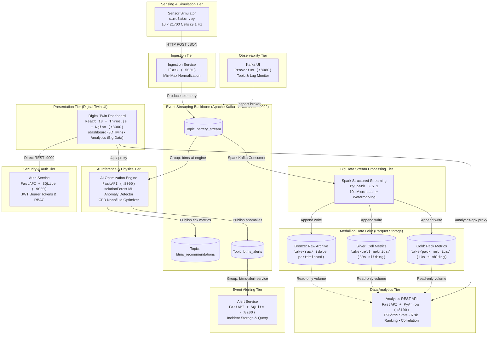
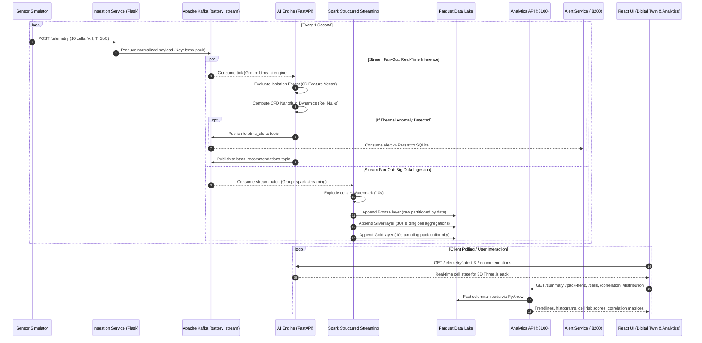

# Battery Thermal Management System (BTMS)

[](docker-compose.yml)
[-231F20?logo=apachekafka&logoColor=white)](https://kafka.apache.org/)
[](https://spark.apache.org/)
[](https://parquet.apache.org/)
[](https://fastapi.tiangolo.com)
[](https://react.dev)
[](https://threejs.org)
[](https://scikit-learn.org)
[](test_report.txt)

> **Enterprise-Grade AI-Driven Predictive Cooling, Event-Streaming Architecture & Big Data Analytics Platform for High-Density 21700 Li-Ion Battery Packs**

---

## ⚡ Overview

The **Battery Thermal Management System (BTMS)** optimizes active thermal control for electric vehicle battery packs using a distributed event-driven microservices architecture. It pairs **Computational Fluid Dynamics (CFD)** physics modeling and **unsupervised machine learning (Isolation Forest)** with an enterprise streaming pipeline powered by **Apache Kafka (KRaft mode)** and **Apache Spark Structured Streaming**, writing directly into a 3-tier **Medallion Parquet Data Lake**.

```
                      ┌────────────────────────────────────────┐
                      │          10 × 21700 Li-Ion Pack        │
                      │  ====================================  │
                      │   ──► Al₂O₃ Nanofluid Microchannels ──►│
                      │  ====================================  │
                      └────────────────────────────────────────┘
                                           │
       ┌───────────────────────────────────┼───────────────────────────────────┐
       ▼                                   ▼                                   ▼
AI Anomaly Detection (ML)       CFD Coolant Optimization          Big Data & Streaming
• IsolationForest (200 trees)   • Dynamic Reynolds Re ∈ [400, 700]• Apache Kafka 3.8.0 (KRaft)
• 8D Multivariate Feature Vector• Al₂O₃ Nanofluid Vol% (0.5%-3.0%)• Spark Structured Streaming
• Pre-Runaway Hotspot Detection • Graetz-Dittus-Boelter Nu Corr.  • Bronze/Silver/Gold Parquet Lake
```

---

## 🚀 Key Features

### 🔄 Distributed Event Streaming with Apache Kafka
- **KRaft Consensus Architecture**: Eliminates Zookeeper dependencies using Apache Kafka 3.8.0 in native KRaft mode (broker + controller in a unified quorum process).
- **Pub/Sub Fan-Out Pipeline**: Multiple independent consumer groups (`btms-ai-engine`, `spark-streaming`, and `btms-alert-service`) consume raw telemetry simultaneously without queue pop contention.
- **Asynchronous Micro-Batched Production**: High-throughput Ingestion service with `confluent-kafka` (`linger.ms=5`, delivery timeout safeguards, and non-blocking event publishing).
- **Event-Driven Incident Alerting**: AI engine asynchronously publishes detected thermal anomalies to dedicated Kafka topics (`btms_alerts` and `btms_recommendations`).
- **Kafka Web Observability**: Integrated Provectus Kafka UI container for real-time inspection of topics, partitions, consumer lag, and message payloads.

### 📊 Big Data Analytics & Medallion Data Lake
- **Spark Structured Streaming Engine**: PySpark 3.5.1 streaming pipeline reading from Kafka with a 10-second micro-batch trigger and schema-on-read JSON flattening.
- **3-Tier Parquet Medallion Lake**:
  - 🥉 **Bronze (`lake/raw/`)**: Immutable, date-partitioned archive of every individual cell reading.
  - 🥈 **Silver (`lake/cell_metrics/`)**: 30-second sliding windows (10-second slide) computing per-cell rolling statistics (mean, min, max, standard deviation, and thermal spike counts).
  - 🥇 **Gold (`lake/pack_metrics/`)**: 10-second tumbling windows calculating pack-level metrics: $T_{\max}$, $T_{\min}$, $T_{\text{avg}}$, thermal uniformity $\Delta T$, and HyperLogLog approximate distinct spiking cells.
- **Fault-Tolerant Checkpointing**: Exactly-once file sink semantics with automatic restart recovery via `_checkpoints`.
- **High-Performance Analytics REST API**: FastAPI service utilizing `pandas` and `PyArrow` for vectorized analytics, percentiles (P95/P99), thermal uniformity compliance ($\Delta T < 5^\circ\text{C}$), Pearson correlation matrices, and composite cell risk ranking.
- **Dedicated Big Data Dashboard (`/analytics`)**: Time-range filtered analytics (5m, 15m, 60m) featuring window trend graphs, temperature distribution histograms, cell risk rankings, sensor correlation heatmaps, and data lake health stats.

### 🧠 AI Anomaly Detection & Physics-Informed CFD
- **Unsupervised ML Anomaly Detection**: `scikit-learn` Isolation Forest inspecting an 8-dimensional feature vector per cell (voltage, current, temperature, SoC, normalized temperature, pack average, pack $\Delta T$, cell-to-pack gradient).
- **Continuous Online Retraining**: Cold-start bootstrap (800 synthetic samples) and rolling background refitting every 50 ticks to adapt to pack aging and environmental drift.
- **Nanofluid Thermal Optimization**: Calculates dynamic thermophysical properties of $\text{Al}_2\text{O}_3$/water nanofluid ($\rho_{nf}$, $\mu_{nf}$, $k_{nf}$), solving Reynolds ($Re \in [400, 700]$) and Nusselt ($Nu$) numbers via Dittus-Boelter and Graetz correlations.

### 🖥️ Digital Twin Visualization & Enterprise Security
- **Interactive 3D Digital Twin**: Three.js WebGL pack visualizer with dynamic thermal gradient shaders and individual cell diagnostics.
- **Enterprise RBAC & Security**: FastAPI authentication microservice with SQLite, `bcrypt` password hashing, and JWT bearer tokens.
- **3-Tier Testing & Verification**: Data-Driven Testing (DDT), Keyword-Driven Testing (KDT), and AI Synthetic Data Generation (**420 tests passing, 100% pass rate**).

---

## 🏗️ Architecture

### High-Level Microservices Architecture



---

### End-to-End Streaming & Analytics Sequence Flow



---

## ☕ Apache Kafka Streaming Architecture

The message backbone is built on **Apache Kafka 3.8.0** operating in KRaft consensus mode, resolving the single-point-of-failure and resource overhead of Zookeeper:

### Topic Taxonomy & Data Contracts

| Topic | Producer | Consumer Groups | Retention | Payload Description |
|---|---|---|---|---|
| **`battery_stream`** | `ingestion-service` | `btms-ai-engine`, `spark-streaming` | 10 min (`600000ms`) | 1 Hz telemetry payload containing tick, timestamp, pack ID, and cell arrays ($V, I, T, \text{SoC}, T_{\text{norm}}$). Partition key: `btms-pack` to maintain sequential integrity. |
| **`btms_recommendations`** | `ai-engine` | Downstream consumers | 10 min | Per-tick active cooling directives: target Reynolds number ($Re$), $\text{Al}_2\text{O}_3$ vol%, pump flow velocity ($v$), and Nusselt number ($Nu$). |
| **`btms_alerts`** | `ai-engine` | `btms-alert-service` | 10 min | Discrete incident events emitted on anomaly detection ($T > 45^\circ\text{C}$ or Isolation Forest outlier). Contains severity, confidence, anomalous cell list, and pack $\Delta T$. |

### Kafka KRaft Configuration Highlights
- **Zero Zookeeper Dependencies**: Unified quorum controller running at port `9093` (`KAFKA_PROCESS_ROLES=broker,controller`).
- **Advertised Listeners**: Dual-network support with `INTERNAL://message-broker:19092` for Docker container bridge networking and `EXTERNAL://localhost:9092` for host tools and local development.
- **Producer Micro-Batching**: `linger.ms=5` enables low-overhead micro-batching without sacrificing millisecond-level responsiveness.
- **Reliable Consumer Offsets**: `btms-alert-service` initializes with `auto.offset.reset=earliest` ensuring zero alert loss upon cold restart.

### Observability with Kafka UI
Inspect live Kafka operations at **[`http://localhost:8080`](http://localhost:8080)**:
- Real-time partition offsets and throughput gauges.
- Consumer group lag monitoring for `btms-ai-engine` and `btms-alert-service`.
- In-flight message deserialization and JSON payload inspection.

---

## 📈 Big Data & Data Analytics Layer

The analytics pipeline bridges real-time stream processing with analytical querying over historical time windows:

```
Kafka Stream ──► Spark Structured Streaming ──► Medallion Parquet Lake ──► Analytics REST API ──► Analytics Dashboard
 (1 Hz ticks)       (10s Micro-batch)               (Bronze/Silver/Gold)       (FastAPI + PyArrow)       (React UI)
```

### Medallion Data Lake Architecture

| Layer | Path | Windowing / Partition | Aggregations & Metrics |
|---|---|---|---|
| **Bronze** | `/data/lake/raw/` | Partitioned by `date` (`YYYY-MM-DD`) | Complete flattened raw record for every cell reading ($T, V, I, \text{SoC}$, spike flag). |
| **Silver** | `/data/lake/cell_metrics/` | 30-second Sliding Window (10s slide) | Per-cell rolling statistics: $\text{avg}(T)$, $\min(T)$, $\max(T)$, $\sigma(T)$, $\text{avg}(V)$, $\text{avg}(I)$, $\text{avg}(\text{SoC})$, spike frequency count. |
| **Gold** | `/data/lake/pack_metrics/` | 10-second Tumbling Window | Pack-level metrics: $T_{\max}$, $T_{\min}$, $T_{\text{avg}}$, thermal gradient $\Delta T = T_{\max} - T_{\min}$, and HyperLogLog cardinality (`approx_count_distinct`) of spiking cells. |

### Analytics REST API Endpoints (`port 8100`)

The Analytics API reads directly from the Parquet lake (mounted read-only) with millisecond response times:

| Endpoint | Method | Query Params | Description |
|---|---|---|---|
| `/summary` | `GET` | `minutes` (default 15) | Headline KPIs: total readings, spike rate %, mean/P95/P99 temperature, mean/P95 $\Delta T$, uniformity compliance % ($\Delta T < 5^\circ\text{C}$), hottest & coolest cells. |
| `/pack-trend` | `GET` | `minutes` (default 15) | 10-second tumbling window time series ($T_{\max}, T_{\text{avg}}, T_{\min}$) from the Gold layer. |
| `/cells` | `GET` | `minutes` (default 15) | Per-cell statistical metrics and **Composite Thermal-Risk Ranking** (weighted score). |
| `/correlation` | `GET` | `minutes` (default 15) | Pearson correlation matrix across temperature, voltage, current, and state of charge (SoC). |
| `/distribution`| `GET` | `minutes`, `bins` | Dynamic temperature frequency histogram with critical 45°C boundary highlighting. |
| `/anomalies` | `GET` | `limit` (default 25) | Audit log of recent windows exhibiting thermal spikes or $\Delta T \ge 5^\circ\text{C}$ violations. |
| `/health` | `GET` | — | Service status and Parquet file count per lake layer (`raw`, `cell_metrics`, `pack_metrics`). |

#### Composite Thermal-Risk Score Formulation
Cells are ranked dynamically using a multi-factor risk index ($0 - 100$ scale):

$$\text{Risk Score} = 0.50 \cdot \text{SpikeRate}_{\%} + 0.35 \cdot \left[\frac{P_{95}(T) - 25}{30} \times 100\right] + 0.15 \cdot \left[\frac{\sigma(T)}{10} \times 100\right]$$

### Visual Analytics Dashboard (`/analytics`)
Access the analytics interface via the top navigation bar or directly at **[`http://localhost:3000/analytics`](http://localhost:3000/analytics)** (Docker) or **[`http://localhost:5173/analytics`](http://localhost:5173/analytics)** (Local dev):
- **Dynamic Time Filters**: Switch instantly between 5-minute, 15-minute, and 60-minute evaluation windows.
- **Pack Thermal Trends**: High-precision SVG time-series visualization tracking pack maximum, average, and minimum temperatures against the 45°C safety ceiling.
- **Pearson Heatmap**: Interactive matrix showing cross-sensor couplings (e.g., negative voltage-temperature correlation during discharge).
- **Cell Thermal-Risk Leaderboard**: Sortable rankings highlighting problematic cells with inline risk score progress bars.
- **Data Lake Telemetry**: Real-time monitor displaying Parquet file volumes across Bronze, Silver, and Gold partitions.

---

## 🛠️ How to Run

### 📋 Prerequisites
- **Docker & Docker Compose**: Recommended for running the full containerized 9-service ecosystem.
- **Python**: `3.11` or `3.12` installed (for local testing or dev server).
- **Node.js**: `18.0+` & `npm` installed (for dashboard development).

---

### Method 1: Full Docker Compose Stack (Recommended)

Spins up the complete event-driven ecosystem: Kafka KRaft broker, Spark Structured Streaming job, Analytics API, Alert Service, AI/CFD Engine, Ingestion Service, Simulator, Auth Service, Kafka UI, and the Nginx-hosted React Dashboard.

```bash
# 1. Clone the repository
git clone https://github.com/shash-17/BTMS-MODA.git
cd BTMS-MODA

# 2. Build and start all 9 microservices in detached mode
docker compose up --build -d

# 3. Check status of all containers
docker compose ps

# 4. View real-time logs across services (Ctrl+C to exit)
docker compose logs -f

# Or stream logs for specific streaming/analytics services:
docker compose logs -f spark-streaming
docker compose logs -f analytics-api
docker compose logs -f ai-engine

# ── Stopping & Teardown ─────────────────────────────────────────────────────

# Stop running containers (preserves Parquet lake & SQLite volumes):
docker compose stop

# Teardown containers and bridge networks:
docker compose down

# Teardown containers, networks, AND persistent volumes (clean slate):
docker compose down -v
```

---

### Method 2: Standalone Local Dev Mode (No Docker or Kafka Required)

For rapid frontend or ML development without starting Kafka or Docker, use the integrated developer server:

#### 1. Start the Unified Backend & ML Engine
```bash
python dev_server.py
```
*Simulates 10 battery cells, runs the Isolation Forest model in-memory, and serves FastAPI on `http://localhost:8000`.*

#### 2. Start the Auth Service (Terminal 2)
```bash
python -m uvicorn auth_service.main:app --host 0.0.0.0 --port 9000
```
*Serves authentication endpoints on `http://localhost:9000`.*

#### 3. Start the Analytics API (Terminal 3 - Optional for lake queries)
```bash
python -m uvicorn analytics.api:app --host 0.0.0.0 --port 8100
```
*Serves analytics queries over existing local Parquet files on `http://localhost:8100`.*

#### 4. Start the React Frontend Dashboard (Terminal 4)
```bash
cd dashboard
npm install
npm run dev
```
*Serves the Digital Twin on `http://localhost:5173` and Big Data Analytics on `http://localhost:5173/analytics`.*

---

## 🌐 Live Endpoints & Service Map

| Service | Mode | Host Port | Container Port | Protocol / Notes | Interactive Documentation / URL |
|---|---|---|---|---|---|
| **Digital Twin Dashboard** | Docker | `3000` | `80` | HTTP / Nginx reverse proxy | [`http://localhost:3000`](http://localhost:3000) |
| **Big Data Analytics UI** | Docker | `3000` | `80` | HTTP / React routed view | [`http://localhost:3000/analytics`](http://localhost:3000/analytics) |
| **Digital Twin (Dev Server)** | Local | `5173` | — | HTTP / Vite HMR | [`http://localhost:5173`](http://localhost:5173) |
| **Kafka UI (Provectus)** | Docker | `8080` | `8080` | HTTP / Topic & Lag Monitor | [`http://localhost:8080`](http://localhost:8080) |
| **AI CFD & ML Engine** | All | `8000` | `8000` | HTTP / FastAPI | [`/docs`](http://localhost:8000/docs) |
| **Big Data Analytics API** | All | `8100` | `8100` | HTTP / FastAPI + PyArrow | [`/docs`](http://localhost:8100/docs) |
| **Alert Service** | Docker | `8200` | `8200` | HTTP / FastAPI + SQLite | [`/docs`](http://localhost:8200/docs) |
| **Auth Service** | All | `9000` | `9000` | HTTP / FastAPI + SQLite | [`/auth/docs`](http://localhost:9000/auth/docs) |
| **Ingestion Service** | All | `5001` | `5000` | HTTP / Flask | [`/health`](http://localhost:5001/health) |
| **Apache Kafka Broker** | Docker | `9092` | `19092` | Kafka TCP / KRaft Mode | `localhost:9092` (host) / `message-broker:19092` |
| **Spark Streaming Job** | Docker | — | — | PySpark 3.5.1 worker | Writes to `/data/lake` volume |
| **Sensor Simulator** | Docker | — | — | Python 3.11 worker | 1 Hz telemetry push to `:5001` |

---

## 🧪 Testing & Quality Assurance

Run the comprehensive test suite locally:

```bash
# 1. Run Data-Driven Pytest Suites (Physics correlations & Ingestion normalizations)
pytest tests/data_driven/ -v

# 2. Run Keyword-Driven Test Harness (Tabular action execution)
python tests/keyword_driven/runner.py

# 3. Generate & Validate AI Synthetic Telemetry Datasets
python tests/synthetic/generator.py --strategy all --ticks 100 --seed 42
python tests/synthetic/validate_synthetic.py
```

### Complete Test Results Summary

The verification pipeline executes **420 total test cases across 3 distinct testing tiers (100% pass rate)**:

```
================================================================================
1. EXECUTIVE SUMMARY & TEST METRICS
================================================================================
  Test Category                  Executed    Passed    Failed    Errors    Pass Rate
  --------------------------------------------------------------------------------
  Data-Driven Tests (Pytest)          185       185         0         0       100.0%
  Keyword-Driven Tests (KDT)           25        25         0         0       100.0%
  Synthetic Data Validations          210       210         0         0       100.0%
  --------------------------------------------------------------------------------
  TOTAL                               420       420         0         0       100.0%
```

Refer to **[test_report.txt](test_report.txt)** for complete test execution traces.

---

## 🔧 Troubleshooting & Port Management

### Freeing Occupied Local Ports
If any service port (`3000`, `5001`, `8000`, `8080`, `8100`, `8200`, `9000`, or `9092`) is occupied by a lingering process:

```bash
# Terminate lingering dev server or uvicorn processes:
pkill -f dev_server.py
pkill -f "uvicorn"

# Force release ports on macOS / Linux:
lsof -ti:3000,5001,8000,8080,8100,8200,9000,9092 | xargs kill -9 2>/dev/null
```

### Inspecting Kafka Topics via CLI
You can also run Kafka CLI commands directly inside the running container:

```bash
# List all active Kafka topics:
docker compose exec message-broker /opt/kafka/bin/kafka-topics.sh \
  --bootstrap-server localhost:9092 --list

# Consume live messages from the raw battery stream:
docker compose exec message-broker /opt/kafka/bin/kafka-console-consumer.sh \
  --bootstrap-server localhost:9092 --topic battery_stream --from-beginning --max-messages 5

# Check consumer group lag:
docker compose exec message-broker /opt/kafka/bin/kafka-consumer-groups.sh \
  --bootstrap-server localhost:9092 --describe --group btms-ai-engine
```

---

## 📚 Detailed Technical Documentation

- **[BTMS_DOCUMENTATION.md](BTMS_DOCUMENTATION.md)**: Mathematical derivations (Navier-Stokes, Graetz-Dittus-Boelter, nanofluid thermophysical equations) and full REST schemas.
- **[KAFKA_SPARK_BIGDATA_NOTES.txt](KAFKA_SPARK_BIGDATA_NOTES.txt)**: In-depth technical architecture notes on Kafka KRaft mode, PySpark Structured Streaming, and Medallion Data Lake storage.
- **[MICROSERVICES_DEVOPS_REPORT.md](MICROSERVICES_DEVOPS_REPORT.md)**: Container orchestration, security audits, networking topography, and DevOps best practices.
